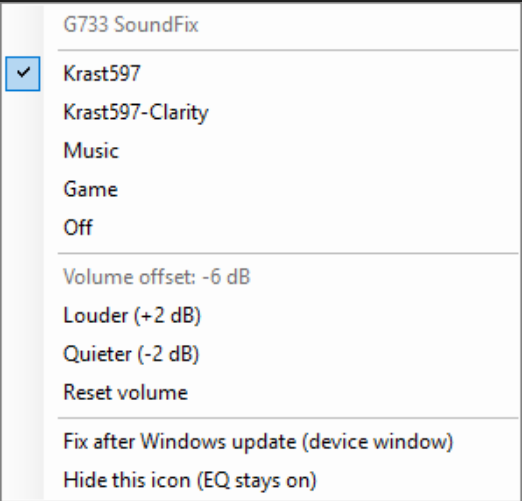
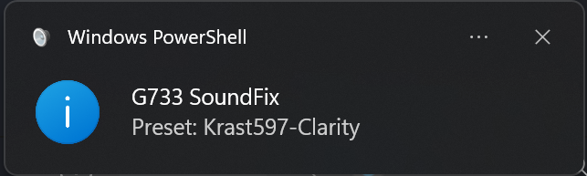
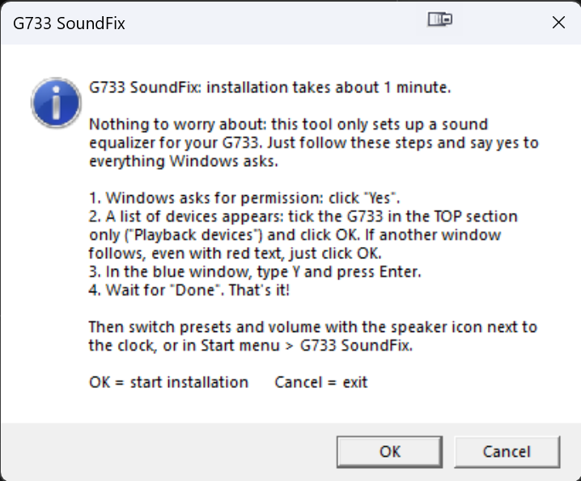
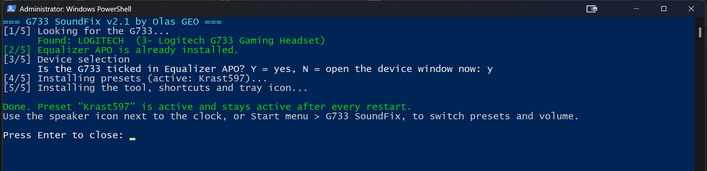
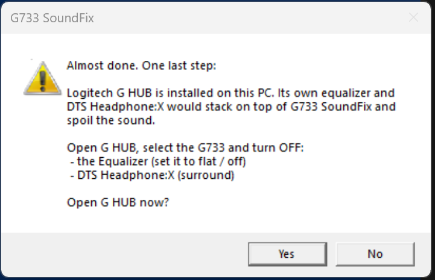

# G733 SoundFix

**by Olas GEO** · sound settings by [u/Krast597](https://www.reddit.com/user/Krast597/)

One-click sound fix for the Logitech G733 headset on Windows.
Logitech G733 ყურსასმენის ხმის გაუმჯობესება Windows-ზე, ერთი დაჭერით.
Исправление звука гарнитуры Logitech G733 в Windows одним нажатием.

[English](#english) · [ქართული](#ქართული) · [Русский](#русский)

  
  &nbsp;
  

More screenshots / სხვა სქრინშოტები / Другие скриншоты

**Welcome message before installation**

**Installer**

**G HUB reminder**

---

## English

### Install: 6 simple steps
1. **Download and extract:** on this page click **Code → Download ZIP**, then extract the file.
2. **Connect the headset:** plug in the USB receiver and turn the G733 on.
3. **Run `Install.bat`** by double-clicking it. A short instruction appears: click **OK**. **Say yes to everything Windows asks** ("More info → Run anyway", "Yes").
4. **When a list of devices appears:** tick the G733 **in the top section only** ("Playback devices") and click **OK**. If another window follows, even one with red text, just click **OK**.
5. **In the PowerShell window** (blue, with text) type **Y**, press **Enter** and wait for **"Done"**.
6. **In Logitech G HUB** turn off the equalizer and DTS surround.

That's it. Switch presets and volume with the speaker icon next to the clock.

### Everyday use
- **Speaker icon next to the clock** (click the "^" arrow if it's hidden): hover to see the active preset and volume; click for the menu: presets (the active one is ticked ✓), **Louder / Quieter** (±2 dB, limited to -12...+4 dB so it won't distort) and **Reset volume**. The icon starts with Windows.
- **Start menu → G733 SoundFix:** the same commands without the icon.
- No Windows permission prompts when switching.

### What it does
`Install.bat`, in one click:
1. Checks that the G733 is connected.
2. Installs **Equalizer APO** (free, open-source system-wide EQ) if missing, downloaded **only from its official SourceForge page**.
3. Asks you to tick the G733 in Equalizer APO's device window. This is the only manual step; Windows offers no safe way to automate it.
4. Installs five presets and activates **Krast597**.
5. Adds the tray icon, a "G733 SoundFix" Start menu folder and an entry in "Settings → Apps"; if G HUB is installed, reminds you to turn its EQ off.

Equalizer APO runs inside Windows audio, so the EQ is **active after every boot** with nothing to launch.

### Presets
| Preset | Purpose |
|---|---|
| **Krast597** (default) | The exact settings from [u/Krast597](https://www.reddit.com/user/Krast597/)'s [guide](https://www.reddit.com/r/LogitechG/comments/10owhnc/guide_to_fixing_sound_on_the_g733/): Peace "Bass and High Boost 2" (preamp -11) + his 15-band EQ |
| **Krast597-Clarity** | Krast597's "{EDIT}" variant: less bass, more clarity and loudness |
| Music | A bit more bass body and air on top |
| Game | Less bass bleed, clearer footsteps and voices |
| Off | No processing, for A/B comparison |

The Krast597 presets don't need Peace installed: its values are written straight into Equalizer APO, so the sound is identical.

Presets are plain text files in `presets` (Equalizer APO syntax) and easy to edit.

### If you also ticked the microphone
Open the Start menu, type **Device Selector**, open it, untick the G733 in the bottom section ("Capture devices") and click OK. Otherwise the EQ is applied to your mic too.

### After a Windows update
A major Windows update can unhook the equalizer. After such an update the tray icon shows a notice: click it (or "Fix after Windows update" in the menu) and tick the G733 under "Playback devices" again. Or just run `Install.bat` again.

### Uninstall
**Settings → Apps → G733 SoundFix → Uninstall** (or `Uninstall.bat`, or Start menu → G733 SoundFix → Uninstall) removes everything the tool added, restores your previous settings, and asks whether to uninstall Equalizer APO too.

### Safety
- Everything is plain text (`.bat`, `.ps1`, `.txt`). Read it in Notepad; nothing is hidden.
- No `.exe` in this repository. Equalizer APO is downloaded only from its official SourceForge page.
- **The installer is verified by its fingerprint (SHA256).** The official `EqualizerAPO-x64-1.4.2.exe` was checked on VirusTotal (0/71, no engine flagged it) and its hash is built into the tool. If the downloaded file differs in any way (e.g. someone tampered with it), installation stops automatically.
- The original of this tool lives only in this GitHub repository. If you got a copy elsewhere, compare it with the files here; they are all plain text.
- The only network access is that one download. No telemetry.
- Administrator rights are needed only during installation, because Equalizer APO and its config live in `Program Files`. To switch presets without a Windows prompt each time, the installer creates 8 small tasks in Windows Task Scheduler. They only run the tool's own scripts from `Program Files`, and `Uninstall.bat` removes them.

### Continue developing with AI
This tool was built with the help of Claude AI. To improve it yourself, use [HANDOFF.md](HANDOFF.md): it holds the full project context and a ready prompt, so you can pick up in Claude (or another AI assistant) exactly where the author left off.

### Credits
The **Krast597** and **Krast597-Clarity** presets are named in honor of their author. All values come from [u/Krast597](https://www.reddit.com/user/Krast597/)'s post on r/LogitechG: [Guide to fixing sound on the G733](https://www.reddit.com/r/LogitechG/comments/10owhnc/guide_to_fixing_sound_on_the_g733/). This tool only makes his solution one click to install.

### Notes
Equalizer APO may not work with some USB or Bluetooth drivers. Not affiliated with Logitech.
Equalizer APO is © its authors, licensed GPL-2.0. This repository's scripts are MIT-licensed.

---

## ქართული

### დაყენება: 6 მარტივი ნაბიჯი
1. **ჩამოტვირთე და გახსენი:** ამ გვერდზე დააჭირე **Code → Download ZIP**, შემდეგ ფაილი გახსენი (Extract).
2. **მიაერთე ყურსასმენი:** USB მიმღები ჩადე და G733 ჩართე.
3. **გაუშვი `Install.bat`** ორჯერ დაჭერით. გამოჩნდება მოკლე ინსტრუქცია, დააჭირე **OK**. **ყველაფერს, რასაც Windows გკითხავს, დაეთანხმე** („More info → Run anyway", „Yes").
4. **როცა მოწყობილობების სია გამოჩნდება:** მონიშნე G733 **მხოლოდ ზედა ნაწილში** („Playback devices") და დააჭირე **OK**. თუ შემდეგ კიდევ ერთი ფანჯარა გამოჩნდება, თუნდაც წითელი წარწერით, უბრალოდ დააჭირე **OK**.
5. **PowerShell-ის ფანჯარაში** (ლურჯი, ტექსტით) ჩაწერე **Y**, დააჭირე **Enter** და დაელოდე წარწერას **„Done"**.
6. **Logitech G HUB-ში** გამორთე ეკვალაიზერი და DTS surround.

მზადაა. პრესეტები და ხმა საათის გვერდით დინამიკის ხატულით გადაირთვება.

### ყოველდღიური გამოყენება
- **საათის გვერდით დინამიკის ხატულა** (თუ არ ჩანს, დააჭირე ისარს „^"): მასზე მიტანისას აქტიური პრესეტი და ხმის დონე ჩანს, დაჭერისას კი მენიუ იხსნება: პრესეტები (აქტიურს ნიშანი აქვს ✓), **Louder / Quieter** (ხმა ±2 dB, -12-დან +4 dB-მდე, რომ არ გაიბზაროს) და **Reset volume**. ხატულა Windows-თან ერთად ირთვება.
- **Start მენიუ → G733 SoundFix:** იგივე ბრძანებები, ხატულის გარეშე.
- Windows ნებართვას ამ დროს აღარ გეკითხება.

### რას აკეთებს
`Install.bat` ერთი დაჭერით:
1. ამოწმებს, მიერთებულია თუ არა G733;
2. საჭიროების შემთხვევაში აყენებს **Equalizer APO**-ს (უფასო, ღია კოდის ეკვალაიზერი Windows-ისთვის). ის ჩამოიტვირთება **მხოლოდ ოფიციალური SourceForge-ის გვერდიდან**;
3. გთხოვს, Equalizer APO-ს ფანჯარაში მონიშნო G733 (ერთადერთი ხელით ნაბიჯი, Windows სხვაგვარად ამის საშუალებას არ იძლევა);
4. აყენებს ხუთ პრესეტს და ჩართავს **Krast597**-ს;
5. აყენებს საათის გვერდით ხატულას, Start მენიუს საქაღალდეს „G733 SoundFix" და ჩანაწერს „Settings → Apps"-ში; თუ G HUB დაყენებულია, შეგახსენებს მისი EQ-ს გამორთვას.

ეკვალაიზერი Windows-ის ხმის სისტემის ნაწილია და **ყოველი ჩართვისას თავისით მუშაობს**, ცალკე პროგრამის გაშვება საჭირო არ არის.

### პრესეტები
| პრესეტი | რისთვის |
|---|---|
| **Krast597** (ნაგულისხმევი) | [u/Krast597](https://www.reddit.com/user/Krast597/)-ის [გზამკვლევის](https://www.reddit.com/r/LogitechG/comments/10owhnc/guide_to_fixing_sound_on_the_g733/) პარამეტრები ზუსტად: Peace-ის „Bass and High Boost 2" (preamp -11) + მისი 15-ზოლიანი EQ |
| **Krast597-Clarity** | Krast597-ის „{EDIT}" ვარიანტი: ნაკლები ბასი, მეტი სიცხადე და ხმამაღლობა |
| Music | ცოტა მეტი ბასი და მეტი სისუფთავე მაღალ სიხშირეებში |
| Game | ნაკლები ბასი, უფრო მკაფიო ნაბიჯები და ხმები |
| Off | დამუშავების გარეშე, შესადარებლად |

Krast597-ის პრესეტებისთვის Peace-ის დაყენება საჭირო არ არის: მისი ციფრები პირდაპირ Equalizer APO-ში იწერება, ამიტომ ხმა იგივეა.

მნიშვნელობები ჩვეულებრივი ტექსტური ფაილებია `presets` საქაღალდეში და მარტივად შეიცვლება.

### თუ მიკროფონიც მონიშნე
Start მენიუში ჩაწერე **Device Selector**, გახსენი, ქვედა ნაწილში („Capture devices") G733-ს მოხსენი მონიშვნა და დააჭირე OK. თორემ EQ მიკროფონსაც დაედება.

### Windows-ის განახლების შემდეგ
Windows-ის დიდმა განახლებამ შეიძლება ეკვალაიზერი გათიშოს. ასეთი განახლების შემდეგ ხატულა შეტყობინებას გაჩვენებს: დააჭირე მას (ან მენიუში „Fix after Windows update") და G733 ისევ მონიშნე „Playback devices"-ის ქვეშ. ან ხელახლა გაუშვი `Install.bat`.

### ამოშლა
**Settings → Apps → G733 SoundFix → Uninstall** (ან `Uninstall.bat`, ან Start მენიუ → G733 SoundFix → Uninstall): შლის ყველაფერს, რაც ხელსაწყომ დაამატა, აღადგენს წინა პარამეტრებს და გეკითხება, წაშალოს თუ არა Equalizer APO-ც.

### უსაფრთხოება
- ყველა ფაილი ჩვეულებრივი ტექსტია: `.bat`, `.ps1`, `.txt`. შეგიძლია Notepad-ით წაიკითხო, დაფარული არაფერია.
- `.exe` ამ საცავში არ არის. Equalizer APO მხოლოდ ოფიციალური SourceForge-ის გვერდიდან ჩამოიტვირთება.
- **ინსტალერი შემოწმებულია „თითის ანაბეჭდით" (SHA256).** ოფიციალური `EqualizerAPO-x64-1.4.2.exe` შემოწმდა VirusTotal-ზე (0/71, არცერთმა ანტივირუსმა საფრთხე არ იპოვა) და მისი ჰეში ხელსაწყოშია ჩაწერილი. თუ ჩამოტვირთული ფაილი ოდნავ მაინც განსხვავდება (მაგ. ვინმემ შეცვალა), ინსტალაცია ავტომატურად ჩერდება.
- ამ ხელსაწყოს ორიგინალი მხოლოდ ამ GitHub საცავშია. სხვა წყაროდან მიღებული ვერსია თუ გაქვს, ფაილები აქაურს შეადარე, ყველა ჩვეულებრივი ტექსტია.
- ინტერნეტთან კავშირი მხოლოდ ამ ერთი ჩამოტვირთვისთვისაა. არც ტელემეტრია, არც მონაცემების გაგზავნა.
- ადმინისტრატორის უფლება მხოლოდ ინსტალაციისას სჭირდება, რადგან Equalizer APO და მისი პარამეტრები `Program Files`-ში ინახება. პრესეტების გადასართავად ინსტალაცია Windows-ის „Task Scheduler"-ში 8 პატარა დავალებას ქმნის, ამიტომ პრესეტების და ხმის შეცვლისას Windows ნებართვას აღარ გეკითხება. ეს დავალებები მხოლოდ ხელსაწყოს საკუთარ სკრიპტებს უშვებს `Program Files`-იდან, და `Uninstall.bat` მათ შლის.

### AI-ით განვითარების გაგრძელება
ხელსაწყო Claude AI-ის დახმარებით შეიქმნა. თუ მისი დახვეწა გინდა, [HANDOFF.md](HANDOFF.md) გამოიყენე: მასში პროექტის სრული კონტექსტია და მზა პრომპტი, რომლითაც Claude-ში (ან სხვა AI ასისტენტში) იმ ადგილიდან გააგრძელებ, სადაც ავტორი გაჩერდა.

### მადლობა
პრესეტებს **Krast597** და **Krast597-Clarity** ავტორის პატივსაცემად მისი სახელი ჰქვია. ყველა ციფრი აღებულია [u/Krast597](https://www.reddit.com/user/Krast597/)-ის პოსტიდან r/LogitechG-ზე: [Guide to fixing sound on the G733](https://www.reddit.com/r/LogitechG/comments/10owhnc/guide_to_fixing_sound_on_the_g733/). ეს ხელსაწყო მხოლოდ მისი გადაწყვეტის დაყენებას ამარტივებს.

### შენიშვნა
ზოგ კომპიუტერზე (ზოგი USB ან Bluetooth დრაივერი) Equalizer APO შეიძლება არ იმუშაოს. ხელსაწყო Logitech-თან დაკავშირებული არ არის.

---

## Русский

### Установка: 6 простых шагов
1. **Скачайте и распакуйте:** на этой странице нажмите **Code → Download ZIP**, затем распакуйте файл.
2. **Подключите гарнитуру:** вставьте USB-приёмник и включите G733.
3. **Запустите `Install.bat`** двойным щелчком. Появится короткая инструкция: нажмите **OK**. **Соглашайтесь со всем, что спрашивает Windows** («Подробнее → Выполнить в любом случае», «Да»).
4. **Когда появится список устройств:** отметьте G733 **только в верхнем разделе** («Playback devices») и нажмите **OK**. Если затем появится ещё одно окно, даже с красным текстом, просто нажмите **OK**.
5. **В окне PowerShell** (синее, с текстом) введите **Y**, нажмите **Enter** и дождитесь надписи **«Done»**.
6. **В Logitech G HUB** отключите эквалайзер и DTS surround.

Готово. Пресеты и громкость переключаются значком динамика возле часов.

### Повседневное использование
- **Значок динамика возле часов** (если не виден, нажмите стрелку «^»): при наведении видно активный пресет и громкость; по нажатию открывается меню: пресеты (активный отмечен ✓), **Louder / Quieter** (±2 дБ, в пределах -12…+4 дБ, чтобы не было искажений) и **Reset volume**. Значок запускается вместе с Windows.
- **Меню «Пуск» → G733 SoundFix:** те же команды без значка.
- Запросов разрешения Windows при переключении нет.

### Что делает
`Install.bat` одним нажатием:
1. Проверяет, подключена ли G733.
2. При необходимости устанавливает **Equalizer APO** (бесплатный эквалайзер с открытым кодом для всей системы). Он скачивается **только с официальной страницы SourceForge**.
3. Просит отметить G733 в окне выбора устройств Equalizer APO. Это единственный ручной шаг: Windows не позволяет безопасно автоматизировать его.
4. Устанавливает пять пресетов и включает **Krast597**.
5. Добавляет значок возле часов, папку «G733 SoundFix» в меню «Пуск» и запись в «Параметры → Приложения»; если установлен G HUB, напоминает отключить его эквалайзер.

Equalizer APO работает внутри звуковой системы Windows, поэтому эквалайзер **активен после каждого включения ПК**, ничего запускать не нужно.

### Пресеты
| Пресет | Назначение |
|---|---|
| **Krast597** (по умолчанию) | Точные настройки из [гайда](https://www.reddit.com/r/LogitechG/comments/10owhnc/guide_to_fixing_sound_on_the_g733/) [u/Krast597](https://www.reddit.com/user/Krast597/): пресет Peace «Bass and High Boost 2» (preamp -11) + его 15-полосный EQ |
| **Krast597-Clarity** | Вариант «{EDIT}» от Krast597: меньше баса, больше чёткости и громкости |
| Music | Чуть больше баса и больше воздуха на верхах |
| Game | Меньше гула баса, чётче шаги и голоса |
| Off | Без обработки, для сравнения |

Для пресетов Krast597 устанавливать Peace не нужно: его значения записываются прямо в Equalizer APO, поэтому звук идентичен.

Пресеты — обычные текстовые файлы в папке `presets` (синтаксис Equalizer APO), их легко изменить.

### Если вы отметили и микрофон
В меню «Пуск» введите **Device Selector**, откройте его, снимите отметку с G733 в нижнем разделе («Capture devices») и нажмите OK. Иначе эквалайзер будет применяться и к микрофону.

### После обновления Windows
Крупное обновление Windows может отключить эквалайзер. После такого обновления значок покажет уведомление: нажмите на него (или «Fix after Windows update» в меню) и снова отметьте G733 в «Playback devices». Либо просто запустите `Install.bat` ещё раз.

### Удаление
**Параметры → Приложения → G733 SoundFix → Удалить** (или `Uninstall.bat`, или «Пуск» → G733 SoundFix → Uninstall) удаляет всё, что добавил инструмент, восстанавливает прежние настройки и спрашивает, удалить ли также Equalizer APO.

### Безопасность
- Все файлы — обычный текст (`.bat`, `.ps1`, `.txt`). Их можно прочитать в Блокноте, ничего не скрыто.
- В репозитории нет `.exe`. Equalizer APO скачивается только с официальной страницы SourceForge.
- **Установщик проверяется по «отпечатку» (SHA256).** Официальный `EqualizerAPO-x64-1.4.2.exe` проверен на VirusTotal (0/71, ни один антивирус не нашёл угроз), и его хэш встроен в инструмент. Если скачанный файл хоть чем-то отличается (например, кто-то его изменил), установка автоматически останавливается.
- Оригинал инструмента находится только в этом репозитории GitHub. Если вы получили копию из другого источника, сравните файлы с этими — все они обычный текст.
- Доступ в интернет нужен только для этой загрузки. Никакой телеметрии.
- Права администратора нужны только при установке, потому что Equalizer APO и его настройки находятся в `Program Files`. Чтобы переключать пресеты без запроса Windows каждый раз, установщик создаёт 8 небольших задач в Планировщике заданий Windows. Они запускают только собственные скрипты инструмента из `Program Files`, а `Uninstall.bat` их удаляет.

### Продолжить разработку с ИИ
Инструмент создан с помощью Claude AI. Чтобы доработать его самостоятельно, используйте [HANDOFF.md](HANDOFF.md): там весь контекст проекта и готовый промпт, чтобы продолжить в Claude (или другом ИИ-ассистенте) с того места, где остановился автор.

### Благодарность
Пресеты **Krast597** и **Krast597-Clarity** названы в честь их автора. Все значения взяты из поста [u/Krast597](https://www.reddit.com/user/Krast597/) на r/LogitechG: [Guide to fixing sound on the G733](https://www.reddit.com/r/LogitechG/comments/10owhnc/guide_to_fixing_sound_on_the_g733/). Этот инструмент лишь позволяет установить его решение одним нажатием.

### Примечание
С некоторыми USB- или Bluetooth-драйверами Equalizer APO может не работать. Проект не связан с Logitech.
